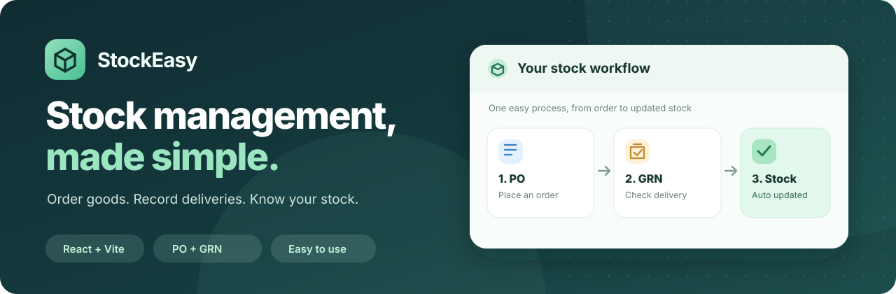

<p align="center"></p>

<h2 align="center">📦 StockEasy — Supun Group Stock Management</h2>
<p align="center">A simple React system to manage goods from Supun branches to customer companies.</p>

## 🔄 How it works
**Supun branch → PO (request) → GRN (receive) → Stock → Customer order → Delivery**

- 🏢 **Branches:** Add, edit, remove or restore Supun branches.
- 📦 **Items:** Photos, stock alerts, buying/selling prices.
- 🧾 **PO + GRN:** Request from any branch; receive full or partial quantities.
- 📊 **Excel PO:** Download an item template, fill quantities, upload and review before saving.
- 🏬 **Customers:** Manage customer companies and orders.
- 🚚 **Deliveries:** Dispatch goods, reduce stock automatically, print delivery notes.
- ↩️ **Returns & corrections:** Reverse mistakes safely with stock history.
- 🔐 **Staff accounts:** Admin, staff and view-only access.
- 📱 **Simple UI:** Icons, gentle animations, mobile layout, light/dark mode.

## 🚀 Run locally
Install [Node.js 22](https://nodejs.org/). On Windows, double-click **`start.bat`** or run:

```bash
npm install
npm start
```

Open **http://localhost:3001**. On the first start, your **admin password appears in the terminal window**. Save it safely (username: `admin` unless changed).

For development: `npm run dev` · Build: `npm run build` · Test: `npm test`

**Built with:** React · Vite · Express · SQLite · Lucide Icons

> ⚠️ **Local-first project:** Back up `database/stockeasy.db` before updating. Existing PO/GRN data is kept when the database is upgraded. Old sample suppliers remain until you remove them. Do not expose this app directly to the internet without further security and deployment review.

<p align="center"><sub>Built with AI assistance · StockEasy for Supun Group</sub></p>
