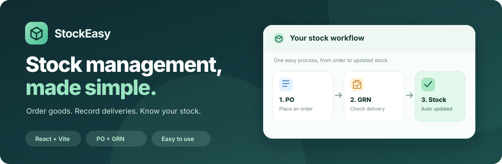

<p align="center"></p>

<h2 align="center">📦 StockEasy — Supun Group Stock Management</h2>
<p align="center">A React application for managing goods from Supun branches to customer companies.</p>

<p align="center"><a href="https://stock.supuncompanies.com/"><b>Visit hosted StockEasy system</b></a></p>

## Project Overview

StockEasy brings purchasing, goods receiving, inventory, quotations, customer orders and deliveries into a connected workflow. It demonstrates business process modelling and practical application interfaces.

## 🔄 How it works
**Supun branch → PO (request) → GRN (receive) → Stock → Customer quotation → Approval → Customer order → Delivery**

- 🏢 **Branches:** Add, edit, remove or restore Supun branches.
- 📦 **Items:** Photos, stock alerts, buying/selling prices.
- 🧾 **PO + GRN:** Request from any branch; receive full or partial quantities.
- 📊 **Excel PO:** Download an item template, fill quantities, upload and review before saving.
- 🏬 **Customers:** Manage customer companies and orders.
- 💰 **Quotations:** Create price offers, record customer approval/rejection, print or save as PDF, and convert approved quotes into one customer order without changing stock.
- 🚚 **Deliveries:** Dispatch goods, reduce stock automatically, print delivery notes.
- ↩️ **Returns & corrections:** Reverse mistakes safely with stock history.
- 🔐 **Staff accounts:** Admin, staff and view-only access.
- 📱 **Simple UI:** Icons, gentle animations, mobile layout, light/dark mode.

## 🚀 Run locally
Install [Node.js 22](https://nodejs.org/). On Windows, double-click **`start.bat`** or run:

```bash
npm install
npm start
```

Open **http://localhost:3001**. On the first start, your **admin password appears in the terminal window**. Save it safely (username: `admin` unless changed).

For development: `npm run dev` · Build: `npm run build` · Test: `npm test`

## Technology

**Frontend:** React · Vite · Lucide Icons  
**Backend:** Express · SQLite

## Quality checks

```bash
npm run build
npm test
```

Use a local database or a separate test environment for development and testing.

> ⚠️ **Local-first project:** Back up `database/stockeasy.db` before updating. Existing PO/GRN data is kept when the database is upgraded. Old sample suppliers remain until you remove them. Do not expose this app directly to the internet without further security and deployment review.

<p align="center"><sub>Built with AI assistance · StockEasy for Supun Group</sub></p>


## Bulk upload existing items and stock (Excel)

**Items → Bulk Upload Excel → Download Current Stock Template → Fill → Upload & Preview → Confirm.**

- Reuse the same 11-column Excel template for your **first migration** and **future item/stock counts**.
- The download includes currently active products, their Product IDs and available stock. Fill new items on blank rows with a **unique Item Code** and leave Product ID empty.
- Columns (in order): Product ID, Item Code, Item Name, Category, Supplier / Branch, Unit, Quantity, Unit Cost (Rs), Selling Price (Rs), Total Cost (Rs), Total Selling (Rs).
- Quantity means the **final available stock**, not stock to add. Example: current 100, Excel 120 → final 120. Calculated totals are for review only.
- Suppliers/branches must already exist in StockEasy and must be spelled as saved. Categories named in Excel are created/reactivated automatically.
- Preview shows new/updated/unchanged items, quantity differences and errors. Nothing is saved until the user checks the confirmation box and clicks Confirm.
- Import requires both **Items edit** and **Stock corrections edit** permissions. Every committed stock difference is recorded in history with a unique BULK reference.
- Repeat imports of the same reviewed inventory data are blocked; changed records after preview require a fresh preview. Existing products omitted from Excel are kept unchanged.
- Unused factory demo categories are archived automatically; categories still assigned to items are retained.
- For **future supplier purchases**, use **PO → GRN**, not Items bulk upload. GRN adds goods, while inventory bulk upload sets a final physical count.
- Back up the database and verify the Excel's quantities before your first real migration.


## Purchase Order (PO) Excel bulk request

- Use **Stock Requests → Create Purchase Order → Download latest PO template** after migrating or updating the Items catalogue. The downloaded workbook is generated from active products with their real Product ID, Item Code, Item Name, Category, Usual Supplier, Unit, Available Stock and Unit Cost.
- Purchase template columns: **Product ID | Item Code | Item Name | Category | Usual Supplier | Unit | Available Stock | Order Quantity | Unit Cost (Rs) | Total Cost (Rs)**.
- Choose the actual PO supplier in the StockEasy form. **Usual Supplier in Excel is for reference only**: a PO can request an item from a different branch.
- Enter new requested quantities in **column H**. Leave items you are not ordering blank. Review or change **Unit Cost (column I)**; Total Cost (column J) calculates automatically. Excel includes bordered rows, quantity/price validation and a How to Fill guide.
- Upload the sheet and review items before saving. Uploading does not create a PO until Save, and saving a PO **never changes current stock**. Stock increases only when actual GRN receipt is saved.
- Do not upload the 11-column Inventory Migration file into the PO importer; that file sets absolute physical stock counts and is handled under Items.
- PO import checks IDs, item codes and product details, rejects repeated products/invalid amounts, and supports at most **200 distinct items** per PO. If the catalogue changes, download a fresh PO template.
